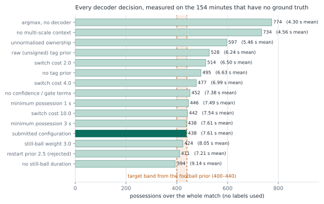

# Pipeline notes: how this submission was built, step by step

This is the working log, not the submitted document. It records what we tried, what the measurements
said, and what we did about it — including the four ideas that failed and the reason each one failed.
The submitted account is [technical-document.md](technical-document.md); the literature that motivated
most of this is [references.md](references.md).

We kept the log for two reasons. The first is that on a three-day problem, the order in which things
were learned matters: several later decisions only make sense as corrections of earlier ones. The
second is that a negative result with a number attached is worth more to the next person than a
positive claim without one.

## Running it

```bash
pip install -r requirements.txt -r requirements-dev.txt

python -m pipeline.data.features          # ~8 s  -> artifacts/features.npz
python -m pipeline.cli.submit --out team-nexus.csv   # ~2 s -> the submission
python -m pipeline.checks.diag --submit   # label-free statistics + a control submission
python -m pipeline.checks.verify          # Smart Tagging as an independent soft oracle
python -m pipeline.cli.ablate             # the ablation table below
python evaluation/run_evaluation.py       # macroF1 / spellF1 on the public window
python -m pytest -q                       # 36 tests, no match data needed
```

Everything the pipeline writes lands in gitignored directories (`artifacts/`,
`evaluation/results/`, `evaluation/reports/`). Nothing in the source tree changes when it runs, which
is why the two report files we cite are committed explicitly rather than picked up by a glob.

---

## Step 1 — Features, and a control that cannot drift

We started by refusing to make a decision. Step 1 turns the tracking, tags and homography into 199
per-frame channels and then measures them with statistics that need no labels at all.

The design of the control matters more than it sounds. We rebuilt the published baseline's rule —
nearest tracked team to the ball, `D` where the ball is absent — *on top of the feature matrix*
rather than next to it. That way the control cannot drift away from the features it is supposed to
represent, and every later comparison is between two things computed from the same array. On the
public window it scores `spellF1` 0.0464 with 95 possessions, which is close to the published 0.0378
for the unsmoothed baseline and is the floor we are measuring against for the rest of this log.

The features themselves:

| group | examples | why it is here |
|---|---|---|
| ball | visibility, gap length either side, interpolated position and its span, velocity, distance to touchlines, outside-the-pitch flag | the ball is absent on 41% of graded frames, and the shape of the absence is evidence |
| ownership | `margin_top3`, distances to the two centroids, players within 5 m and 10 m | possession belongs to a neighbourhood, not to the last player to touch the ball |
| team shape | centroid, spread, centroid distance, share of tracked players | the only read available when the ball is gone |
| movement | mean speed, share still, share moving quickly | dead-ball evidence that survives a lost ball |
| duration | ball-stationary run length, and that combined with slow players | "the ball has not moved for six seconds" is not expressible instantaneously |
| restarts | set-piece flags and type, shaped restart prior, signed tag prior | every restart ends a dead stretch |
| context | 7 channels × 8 log-spaced lags (0.4–64 s) × past and future, plus rolling means | multiplies the reach of every other channel |
| boundaries | graded flag, frames from half start, frames to half end | two halves, and 2,934 all-`D` frames before the second-half kickoff |

Context is acausal. The submission is scored offline, so future frames cost nothing, and having them
is what makes boundary placement possible rather than lagged by a second.

**Two things broke here, both worth recording.** The obvious Smart Tagging parse, `findtext("Team")`,
returns nothing on this file and yields an all-unknown team tag that looks like real data; the nested
`<label><group>/<text>` structure has to be walked. And the ATD's `frame_id` runs 1…199,319, so a
reader that takes it at face value puts the whole submission one frame out. `load_atd()` now asserts
the exact sequence and stores it at 0…199,318. Both bugs were caught by comparing counts against
`DATA.md` — 56.9% ball visibility overall, 59.3% graded, and the tag instance counts — which is the
cheapest sanity check in the repository and the one we would recommend first.

---

## Step 2 — The decoder, and the first large jump

Evidence per frame, then a sequence through it. `pipeline/model/emissions.py` scores `dead` and
`possession` as log-odds; `pipeline/model/decode.py` runs Viterbi over `{H, A, D}` and then absorbs
runs that are too short to be real.

The switch costs carry the football: changing team costs 6.0 log-odds, entering or leaving a stoppage
costs 2.5. One constant says "a change of possession is a specific event"; the other says "stoppages
are frequent and brief". Cleanup then enforces a minimum dwell — 3 s for a possession, 1 s for a
stoppage — and never merges a dead stretch, because `H H D D H H` is two possessions and merging it
would erase the thing the metric counts.

That took the public window from 0.4242 (`spellF1`, best published baseline) to 0.4343 with
`macroF1` 0.6439, and the full match from a 2-second flicker to a plausible structure. Most of the
remaining log is about the ways that first version was wrong.

---

## Step 3 — Ownership was biased by slot count, and the tag prior was inverted

**Ownership.** `score_margin` summed `exp(−d/4 m)` over *every* slot a team had. This match carries 24
home slots and 22 away, so a duplicated track eight metres from the play was worth 0.14 to that team
for free, and the predicted home share of live play ran 0.709 against a truth of 0.573. Replacing the
sum with the mean weight of each team's **three nearest** players made the score invariant to slot
count and closer to the five-nearest-players representation in Borghesi et al. Predicted home share
fell to 0.638 before the tag fix and 0.619 after; possessions in the window went 22 → 18.

**The tag prior had two independent bugs**, both found by measuring the prior instead of trusting it.

1. Defending codes are tagged with the team *without* the ball, and Defensive Transition with the team
   that just lost it. Using the raw `Team` value pushed possession the wrong way for roughly a third
   of the match. The prior now carries a sign per code.
2. Every phase appears twice — once with the attacking team's code, once with the defending team's
   code over the same interval (`PROGRESSION` and `DEFENDING IN MIDDLE THIRD` have identical frame
   counts, as do the two transition codes). The first implementation assigned a per-frame team tag
   instance by instance, so the last write won and the tag was effectively random inside a phase. It
   now accumulates the signed team over both instances and averages.

After the fix the prior is genuinely informative: P(home | prior says home) = 0.769 against a 0.573
base rate, and P(home | prior says away) = 0.435. It enters at 0.35 log-odds, deliberately below the
geometry: at 0.6 the prior takes over and accuracy on live frames falls 0.810 → 0.734.

Window after this step: `macroF1` 0.6511, `spellF1` 0.4471, 17 possessions, D-class F1 0.48.

---

## Step 4 — One rejection and one adoption

**Restart-aware dead ball: rejected.** The hypothesis was attractive. A tagged `SET PIECES` interval
spans the restart, so its shape could place the dead ball, and the prior is real: P(dead at the start
of a set-piece interval) = 0.571 against a 0.196 base rate. It still made everything worse.

| `dead_restart` weight | D recall | D precision | team accuracy | predicted dead share |
|---|---|---|---|---|
| 0.0 | 0.41 | 0.58 | 0.773 | 0.446 |
| 2.5 | 0.43 | 0.52 | 0.747 | 0.493 |
| 4.0 | 0.49 | 0.47 | 0.708 | 0.523 |

Recall rises by claiming live frames, because 43% of an interval start is *not* dead: play resumes
inside the interval and nothing in the data says when the ball was struck. The `Kick Off (Start)`
instance spans 443.88–448.88 s for a kickoff struck at 447.44 s, and that offset is not constant
across set-piece types. The weight is 0 by default, the feature and kernel stay in the code, and what
would make restarts usable is a ball-struck-time detector, not a prior.

**Ball-stationary duration: adopted.** No instantaneous channel could express the thing that actually
matters at a free kick or a throw-in: the ball has not moved for six seconds. A run-length feature
(`ball_still_frames`) and its product with player slowness (`dead_still_combo`) fixed the population
the model had been missing entirely:

- P(dead | ball still > 2 s and players slow) = 0.494 against a 0.196 base rate, covering 40% of dead
  frames — the ones with a *visible* ball.
- At weight 4.0: D recall 0.41 → 0.56, D precision 0.58 → 0.68, team accuracy 0.773 → 0.797.

Weights 3/4/5/6 gave `spellF1` 0.4343 / 0.4444 / 0.4111 / 0.3568 and `macroF1` 0.6699 / 0.7205 /
0.7548 / 0.7504, so 4.0 was where both metrics improved and the dead share stayed closest to the
football prior. Above it the decoder starts calling live frames dead.

Minimum possession went 2 s → 3 s in the same pass, on the definition in `CHALLENGE.md` and on
label-free structure: 398 possessions at 8.45 s mean against 401 at 8.38 s. Both metrics agreed, which
is unusual enough to be worth writing down.

Window after this step: 0.7335 / 0.4571, 18 possessions, D-class F1 0.68.

---

## Step 5 — Three corrections, one of which was a sign error

**The gap-to-dead weight was far too high.** The ground truth is derived from corrected tracking,
which knows the ball is in play while ours has lost it. In the public window, 391 truth-alive frames
had a median ball gap of 5.6 s, and our weight called 98.7% of them dead. Lowering `dead_per_second`
0.55 → 0.40 and the long-gap bonus 1.2 → 0.8 raised D precision 0.69 → 0.75 with recall unchanged.

**The formation term enters with the opposite sign to the intuitive one.** Missing-ball frames were the
one population the model could not reach. The team centroid does reach them, but not in the direction
we assumed. On ball-absent frames in the public window, the team whose centroid was *nearer* the ball
was defending 384 times out of 384 — the side out of possession compacts around the ball while the
side in possession spreads into its shape. With the ball visible the relation inverts, so the term is
gated on the ball being absent. Adding it the natural way round made away recall worse (0.756 →
0.721). With the sign corrected:

| `shape_scale` | A recall | team accuracy | boundary latency |
|---|---|---|---|
| 0.0 | 0.756 | 0.813 | −6.6 frames |
| **−0.10** | **0.765** | **0.817** | **−1.1 frames** |
| −0.25 | 0.809 | 0.836 | −4.3 frames |

We use −0.10. −0.25 buys more recall but inflates the possession count.

**The interpolation discount had become harmful.** Discounting ownership evidence by
`exp(−span/2 s)` made sense in Step 2, when an interpolated ball was the only read on a missing one.
With the formation fallback in place it discards good evidence: team accuracy 0.817 → 0.835 without
it, away recall 0.765 → 0.807, share error 0.011 → 0.002, structure unchanged. It is now 0.

**A warning about measurement noise, because we nearly fooled ourselves.** `abl_no_confidence` and
`abl_final` are now the *same configuration*: the discount is off by default, and the ablation sets it
to `1e6`, which is `exp(−span/1e6) ≈ 0.99999` rather than exactly 1.0. That 1e-5 breaks ties
differently in the Viterbi argmax: 568 frames change and the public `spellF1` moves 0.4800 → 0.4947.
A 0.015 difference between two identical models. This is the concrete version of the warning in
`EVALUATION.md`: on 17 possessions, treat anything under about 0.04 as noise and do not read the third
decimal at all.

Window after this step: 0.7666 / 0.4800, 18 possessions, share error 0.002, boundary latency −1.1.

---

## Step 6 — Two more ideas, both rejected on measurement

**Team spread is predictive and still harmful.** The team in possession spreads; the team defending
stays compact. Measured on the public window it separates cleanly in both populations — P(home) =
0.840 when home is more spread with the ball visible, and the same sign with the ball absent, so no
gating is needed. Added as an additive logit it did what a strong feature should: live-frame accuracy
0.835 → 0.859, `macroF1` 0.7666 → 0.7856. It also wrecked the ranking metric.

| `spread_scale` | possessions (truth 17) | mean duration | macroF1 | spellF1 |
|---|---|---|---|---|
| 0.0 | 18 | 14.3 s | 0.7666 | **0.4800** |
| 0.1 | 16 | 16.2 s | 0.7668 | 0.4970 |
| 0.5 | 15 | 17.3 s | 0.7597 | 0.3750 |
| 1.0 | 12 | 21.8 s | 0.7811 | 0.4000 |
| 1.5 | 8 | 33.1 s | 0.7856 | 0.4320 |

The mechanism is plain: a heavy term makes the decoder confident, so it stops switching and merges
possessions. Non-monotonic in `spellF1`, inside the noise band at low weight, so the default is 0.

**A learned emission cannot beat its teacher.** `pipeline/model/learn.py` trains a gradient-boosted
classifier on our own pseudo-labels, out-of-fold by half so training and prediction never share a
half, then mixes it with the rule emission and decodes with the same Viterbi. The features generalise
(92.8% out-of-fold agreement with the rules), which is a useful independent check on the feature set.
Every mixture weight still degraded `spellF1` — 0.4800 → 0.4000 at the time of the test, at alpha 0.2,
0.35, 0.5 and 1.0 alike — because the student learns the teacher's per-frame decisions without its
structural decoding, and so reintroduces exactly the flicker the decoder exists to remove.

---

## Step 7 — What the video showed, and the single largest gain

The visual check was supposed to be a formality. `pipeline/checks/render.py` projects every tracked
slot through the frame's homography, colours players by team, marks the ball, and burns in the
predicted label plus the evidence behind it.

We rendered the longest disagreement with the ground truth: frames 18,127–18,362, 9.4 s where the
truth says dead and we said home. The frames show a restart being set up. The ball is visible and
motionless for eight seconds, one player stands beside it, everyone else is jogging into position, and
the set-piece flag is on. Our dead head had no term for that combination: its stillness feature needs
*slow players*, and these players are moving at 1–3 m/s.

Measured before touching the model: inside a set-piece interval, with a visible ball stationary for
more than 4 s, P(dead) = 0.830, against 0.561 for a set piece alone and 0.140 for stillness alone. A
restart cannot get underway while the ball is not moving, so this is a football rule rather than a
patch for one incident.

| `dead_set_piece_still` | D precision | D recall | D F1 | possessions | macroF1 | spellF1 |
|---|---|---|---|---|---|---|
| 0.0 | 0.836 | 0.594 | 0.694 | 18 | 0.7666 | 0.4800 |
| **2.0** | **0.840** | **0.754** | **0.795** | **17** | **0.8073** | **0.4941** |
| 3.5 | 0.840 | 0.754 | 0.795 | 17 | 0.8073 | 0.4941 |

It saturates at 2.0, both metrics improve, and the possession count lands on the truth's 17. Two other
candidates from the same investigation were rejected: "set piece and still ball" without the 4 s
threshold (P(dead) = 0.597, too weak) and an "isolated ball" signature (P(dead) = 0.195, i.e. nothing).

This is the step we would point to if asked why the video check was worth the day it cost.

---

## Verification, and one lesson about verifiers

Two tools, because the question has two halves. `pipeline/checks/verify.py` uses Smart Tagging as an
independent soft oracle over the whole match; `pipeline/checks/render.py` draws the tracking onto the
video so a human can look.

The oracle results are in the submitted document: `PROGRESSION` 0.939 (majority baseline 0.712),
`DEFENDING IN MIDDLE THIRD` 0.939, restarts 0.963 (baseline 0.593), `ATTACKING TRANSITION` 0.833,
`GOALS` 3 of 4. The zone and action codes sit at 43–59%, below their baselines, and we report them as
invalid checks rather than as failures — rendering the frames showed the tag can sit over the aftermath
of the action.

The first version of the verifier printed three alarming results, and all three were bugs in the
verifier: an inverted `expected_sign` that treated every non-possession code as the defending team
(`ATTACKING TRANSITION` 1/24, `GOALS` 0/4), phases outside the graded halves being scored at all, and
corners being scored as though the team that took one should still hold the ball after the cross
(20/27 "failures"). An unverified verifier produces numbers that look like findings.

On the rules boundary: watching the video is allowed, turning what you saw into labels or
frame-specific constants is not. Both tools only report, neither writes a submission, and the constant
that came out of Step 7 came from an aggregate rate over hundreds of frames.

---

## What the pipeline looks like, in possessions

The final ablation, measured on the whole match with no labels involved. The band is roughly 200
possessions per half, from the football prior on possession length.



*The bar is the possession count over the whole match; the number beside it is the mean possession
duration. The shaded band is where a possession count should land given a 400–440 possession match,
which is what the football prior on possession length implies over ~106 minutes of play.*

Reading it honestly: the multi-scale context and the switch penalty do most of the work; the tag prior
is worth about 80 possessions of structure; the still-ball duration term is what keeps the dead share
near the football prior. Two mechanisms motivated by the literature — the interpolation discount and
the distance gate — turned out to be worth nothing once the context and shape terms were in place.

## Where the headroom is

Feature engineering is close to exhausted on this data: three candidate signals were tested in Step 6,
two were rejected outright, and the third raised `macroF1` while costing the ranking metric. Learning
from pseudo-labels cannot exceed its teacher, which we measured rather than assumed.

What is left is sequence structure. We still match only 6 of 20 true transitions within ±25 frames,
and when we are wrong it is about *which* transitions exist rather than where they sit. The instrument
for that is the one the literature points at and we have not built: a hidden semi-Markov decoder with
explicit per-state duration distributions, replacing the constant switch penalty plus dwell cleanup.
The other open item is the dead-share drift across the match, documented in the submitted document §8:
our dead-ball evidence leans on ball absence, and the ball is visible on 88% of the frames we are
allowed to look at and 56–59% of the rest.
