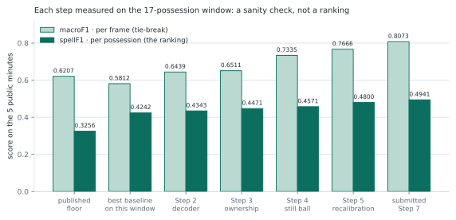
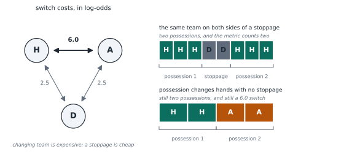
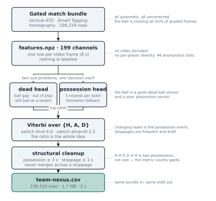
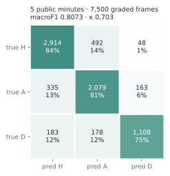
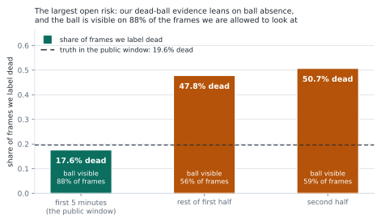

# Who has the ball? A tracking-only possession decoder for one LaLiga match

**Team Nexus** · More than a Hack 2027, Phase 1
FC Barcelona vs Athletic Club, LaLiga EA Sports 2024-25, matchday 2
Repository: [github.com/aditwidi/mtah2027-team-nexus](https://github.com/aditwidi/mtah2027-team-nexus)
Submitted file: `team-nexus.csv` — `frame,label`, 199,319 rows, labels `H` / `A` / `D` / `X`

Uploaded as `team-nexus.md`. The repository is the authority on every number in this document; the
per-step measurements are in `docs/pipeline.md` and the literature review in `docs/references.md`.

---

## 1. What we submitted, and what it scores

The submission is a deterministic pipeline. It reads the tactical tracking, the Smart Tagging and the
homography, scores every frame for "dead" and for "home vs away", and then decodes the whole match
into possessions. There is no trained model and no video in the pipeline.

Scored on the five public minutes with `evaluation/run_evaluation.py`:

| submission | macroF1 | spellF1 | possessions (truth 17) | mean possession (truth 14.2 s) | D-class F1 |
|---|---|---|---|---|---|
| published floor (`baseline_smooth50`) | 0.6207 | 0.3256 | 26 | 10.8 s | 0.32 |
| best published baseline on this window (`smooth125`) | 0.5812 | 0.4242 | 16 | 18.5 s | 0.15 |
| **`team-nexus.csv`** | **0.8073** | **0.4941** | **17** | **14.5 s** | **0.795** |

Per class: H 0.846, A 0.781, D 0.795. Accuracy 0.813, Cohen's κ 0.703. Boundary latency −2.7
frames. Fragmentation 1.19 (25 predicted segments against 21 in the truth).

On the 154 minutes that carry no labels we can only measure structure, and that is what we tuned on:

| | value |
|---|---|
| possessions | 438 (208 first half / 230 second) |
| mean possession | 7.61 s |
| dead share | 0.478 |
| home share of live play | 0.564 |
| transitions | 6.8 per minute |



*The path from the published floor to the submitted configuration. The last two bars are the same
code with the set-piece term switched off and on.*

One warning before the numbers are read as a ranking. The public window is 17 possessions. Two
configurations of ours that are identical in code, differing only in whether an `exp()` underflows to
1.0, flip 568 frames of Viterbi tie-breaking and move `spellF1` by 0.015 — on a window where the whole
span from the published floor to our result is 0.17. Anything under about 0.04 here is noise, and
`EVALUATION.md` says the same thing from the organisers' side. We report the window because we must,
and we chose every constant on priors and on label-free structure, not on this number.

---

## 2. What the metric forced us to build

`spellF1` matches whole possessions one-to-one by temporal overlap. That changes the shape of the
solution. The organisers' own baselines make the point better than we can: the same algorithm four
times, differing only in a majority-vote window, moves `spellF1` from 0.0378 to 0.4242 while
`macroF1` stays between 0.58 and 0.62. A per-frame classifier is therefore the wrong instrument — a
single flickering frame can both break a true possession and invent a false one.

So we separated the problem into evidence and structure:

- **Evidence** is per frame and unconstrained: how likely is the ball dead, how strongly does the
  geometry favour home over away.
- **Structure** is per sequence: which label sequence best explains the evidence, given that a
  possession lasts seconds, that changing team is a specific event, and that `H H D D H H` is two
  possessions rather than one.

The second part is where most of our score comes from, and it is also where the challenge definition
does the design work for us. `CHALLENGE.md` settles three things we would otherwise have guessed at:
a possession is a maximal run of one team with the ball alive; a dead ball is a stoppage and never a
possession; and a stoppage between two runs of the same team keeps them separate.



*Left: the three states and the switch costs the decoder charges for moving between them. Right: the
two cases `CHALLENGE.md` settles for us — a stoppage between two runs of the same team keeps them
separate, and a change of team is a possession event even with no stoppage in between.*

The other thing the metric does is punish the wrong kind of error asymmetrically. Missing a stoppage
merges two possessions into one, which costs two matches. Inventing a stoppage splits one possession
into two, which also costs two. There is no cheap error here, which is why the decoder needed explicit
dwell times on both states rather than a smoothing window.

---

## 3. The pipeline



*Everything above is deterministic and rebuilt in about ten seconds; the gated bundle is the only
input. The two heads never see each other, and the decoder is the only place where the three labels
compete.*

### 3.1 Reading the data, and getting the frame index right

Everything is indexed by video frame, because that is the only index that matters: row *i* of the
submission is frame *i* of the tactical video. The ATD's `frame_id` runs 1…199,319, so
`load_atd()` asserts that exact sequence and stores it at 0…199,318. If the file were ever off by one,
the pipeline fails loudly instead of scoring subtly wrong for two hours.

Smart Tagging timestamps are seconds from the first video frame, so `round(seconds × 25)` is the
frame. We checked that against both kickoffs rather than trusting it, and we checked the parse against
`DATA.md`: the instance counts match exactly (97 / 93 / 72 / 66 / 66 / 59 for the six most common
codes, `Team` 314 Barcelona / 288 Athletic / 36 `N/A`, `Half` 320 + 318, set-piece types 26 / 12 / 10
/ 5 / 4 / 2). That mattered because the obvious parse, `findtext("Team")`, silently returns nothing
on this file and gives an all-unknown team tag that looks like data.

### 3.2 Features

199 channels, each defined on every frame, built once in about eight seconds.

| group | what it holds | why it is there |
|---|---|---|
| ball | visibility, gap length before and after, interpolated position and its span, velocity, distance to the touchlines, an outside-the-pitch flag | the ball is missing on 41% of graded frames; the pattern of absence is itself evidence |
| ownership | `margin_top3`: mean weight of each team's three nearest players to the ball, blended over the current frame, ±1 s and ±4 s; distances to each team's centroid; counts within 5 m and 10 m | possession is a property of the neighbourhood, not of whoever touched it last |
| team shape | centroid per team, spread, the two centroids' distance, share of tracked players per team | gives a read on the missing-ball frames |
| movement | mean tracked speed, share of players nearly still, share moving quickly | the dead-ball signal that survives a lost ball |
| duration | how long the ball has been stationary, and that combined with slow players | no instantaneous channel can say "this ball has not moved for six seconds", which is what a free kick being placed looks like |
| restarts | set-piece flags and type, a shaped restart prior, a signed tag-based team prior | a restart always ends a dead stretch |
| context | seven channels at eight log-spaced lags (0.4 s to 64 s) both backwards and forwards, plus rolling means | multi-scale context is the cheapest win in the published work; the submission is scored offline, so future frames are free |
| boundaries | graded flag, frames since the half started, frames to the half end | the two halves, and the 2,934 all-`D` frames before the second-half kickoff |

### 3.3 The dead head

Dead ball is scored as log-odds from evidence that is mostly physical, because the ball itself
disappears exactly when it matters: a per-second cost for ball absence (capped at eight seconds), a
large bonus if the ball's coordinates are outside the pitch, a bonus inside a set-piece interval, a
term for a stationary ball combined with slow players, and a prior against calling dead at all.
The constants are stated priors from football, not fitted values — professional football has 55 to 60
minutes of effective play in 90, so roughly 35–40% of the clock is dead.

Two of those constants came out of measurement, and both first guesses were wrong:

**The gap-to-dead weight was far too strong.** The ground truth comes from *corrected* tracking, which
knows the ball is in play while ours has lost it. In the public window, 391 truth-alive frames had a
median ball gap of 5.6 seconds, and our original weight called 98.7% of them dead. Cutting the
per-second weight from 0.55 to 0.40 and the long-gap bonus from 1.2 to 0.8 raised `D` precision from
0.69 to 0.75 with recall unchanged.

**A set piece with a stationary ball is dead, and the model could not say so.** The stillness feature
needs *slow players*; at a throw-in or a free kick the players are jogging into position at 1–3 m/s
while the ball sits still. Inside a set-piece interval with a visible ball unmoved for more than four
seconds, the public window gives P(dead) = 0.830, against 0.561 for a set piece alone and 0.140 for
stillness alone. Adding that one term raised `macroF1` 0.7666 → 0.8073 and `spellF1` 0.4800 → 0.4941,
and it brought the possession count from 18 to 17, which is the truth's count. It also saturates: at
weight 2.0 and 3.5 the output is identical.

### 3.4 The possession head

The emission for home vs away is the difference between two neighbourhood scores, not a nearest-player
vote. For each team we take the three nearest tracked players to the ball and average
`exp(−distance / 4 m)`. A team with more tracked slots cannot win by arithmetic, which matters here
because the metadata carries 24 home slots against 22 away and an unnormalised sum gave home a free
advantage of about 0.14 whenever a duplicate track was near the play.

When the ball is missing, the only usable geometry is the two teams' shapes, and the obvious
direction for it is wrong. On ball-absent frames in the public window, the team whose centroid was
*nearer* the ball was the defending team in 384 cases out of 384: the side out of possession is
compact around the ball while the side in possession spreads into its structure. With the ball
visible the relation inverts again, so the term is gated on the ball being absent and enters with a
negative sign. Adding it the natural way round lowered away recall from 0.756 to 0.721.

### 3.5 Decoding, and the two constants that matter

Viterbi over three states, with asymmetric switch costs in the same log-odds units:

```
       6.0              6.0
   H ◀──────▶ A    ← changing team is the possession event
   ▲            ▲
   │ 2.5     2.5│   ← stoppages are frequent and brief
   ▼            ▼
        D
```

The ratio is the whole idea. A stoppage is cheap to enter and cheap to leave; a change of team is
expensive. Then a cleanup pass removes runs shorter than the minimum dwell — three seconds for a
possession, one second for a stoppage — absorbing each into its better neighbour with a fixed
priority (same label first, then a blip inside a stoppage, then a short stoppage inside a possession).
A dead stretch is never merged across, because `H H D D H H` is two possessions and merging it would
destroy the very thing the metric counts.

Two candidate refinements were built, measured and left off. Re-placing each boundary at the
maximum-likelihood change point of the instantaneous scores moved 40 frames and changed nothing at
any window from ±25 to ±100 frames. A confidence discount on interpolated ball positions became
strictly harmful once the formation term existed. Both remain in the code behind a default of zero,
because shipping a mechanism that claims to help and measurably does not is worse than shipping
nothing.

---

## 4. Checking ourselves on the 154 minutes that have no labels

Five minutes of truth is not enough to validate a two-hour submission, so we built two independent
checks.

**Smart Tagging as a soft oracle.** It is produced by a separate automatic process from the same
video and names a team for 602 of its 638 phases, so it covers the whole match and is independent of
our pipeline. It is not ground truth, but it is evidence. On 27 restarts, the tagged team appears in
the phase 96.3% of the time against a 59.3% majority baseline. On the 66 `PROGRESSION` phases the
tagged team holds the ball at the phase start 93.9% of the time (majority baseline 71.2%), and on the
66 `DEFENDING IN MIDDLE THIRD` phases — the same intervals, tagged with the *defending* team — the
opposite holds at 93.9%. `ATTACKING TRANSITION` 83.3% and `GOALS` 3 of 4 follow the same logic.

The zone and action codes (`BALL IN THE BOX`, `CREATING CHANCES`, `LONG BALL`) sit at 43–59%, below
their majority baselines, and we do not report them as possession checks. Rendering the frames showed
why: the tag can sit over the aftermath of the action it describes. Frame 36813 is a `BALL IN FINAL
THIRD` phase we "fail": players walking, ball untracked, everyone at 1.0–1.4 m/s, and our label `D`.
The video agrees with us and the code is simply not a possession statement.

**The video overlay.** `pipeline/checks/render.py` projects every tracked slot through the frame's
homography, colours players by team, marks the ball, and burns in the predicted label plus the
evidence behind it. It paid for itself immediately. Rendering the longest disagreement with the truth
— frames 18,127–18,362, where the truth says dead and we said home — showed a restart being set up:
ball visible and motionless for eight seconds, one player beside it, everyone else jogging into
position. That is the incident that produced the set-piece-and-still-ball term in §3.3, and it is the
single largest gain in the project.

The same check also found three bugs in our own verifier, each of which had been printing alarming
numbers: an inverted sign that made every attacking transition look like a failure, phases outside
the graded halves being scored at all, and corners being scored as if the team taking them should
still hold the ball after the cross. An unverified verifier produces numbers that look like findings.
Every figure above is after those fixes.

**What the video did not do.** Watching is explicitly allowed by the rules; turning what we saw into
labels or frame-specific constants is not. Both tools only report, neither writes a submission, and
the constant that came out of the video check came from an aggregate rate over hundreds of frames
(P(dead) = 0.830 inside a set piece with a still ball), not from the frames we looked at.

---

## 5. The possession rules we implemented

| rule from `CHALLENGE.md` | how the pipeline implements it |
|---|---|
| the ball is dead where the referee would say so | out-of-play ball, long absence, set-piece interval, stationary-ball set-up, player stillness, plus the published pre-kickoff block |
| while contested or loose, possession stays with the last team | the team-switch cost (6.0) exceeds anything a loose or missing ball can contribute, so the state persists |
| a touch is not a change of possession | the ownership evidence is a neighbourhood average over multiple time scales, so one touch cannot flip a label |
| controlled possession = kept for a few seconds, or two or more passes | minimum possession dwell of 3 s; anything shorter is absorbed and never reported |
| `H H D D H H` is two possessions | dead stretches are never merged across in cleanup |
| dead-ball ownership is not asked for | every dead frame is `D`; we never try to name the restarting team |
| `X` means no answer | written only outside the graded halves (40,462 frames). We never abstain inside a half: the scorer forward-fills an `X`, so abstaining mid-possession is neutral and abstaining across a hand-over is actively harmful |

---

## 6. Training data

**None. The pipeline has no learned parameters and no training set of any kind.**

No external dataset was used — no SoccerNet, no Metrica open matches, no event data, no corrected
tracking, nothing hand-labelled. Nothing from this match was used to fit or validate a model, and
there is nothing to fit: the two emissions are stated in log-odds and the decoder has six constants.

The five published minutes were used in four ways, and two of them sit close enough to the line that
we would rather name them than be asked:

1. **Verification** — frame alignment, the Smart Tagging time base, the file format.
2. **Feature semantics** — the use the documentation explicitly encourages. We measured directional
   facts such as P(dead | ball outside the pitch) = 27.6% against 0.0% on live frames, the speed of
   players on dead versus live frames, and the centroid inversion. These are properties of the data,
   not coefficients fitted to it.
3. **A consistency check of the final score** — printed, never used to choose a feature set.
4. **Two tie-breaks** between values that were already defensible on label-free grounds: minimum
   possession 2 s versus 3 s, and the formation weight −0.10 versus −0.25. Both differences sit inside
   the noise band in §1 and neither changes the method.

The priors themselves come from football and from published work, not from this match: effective
playing time for the dead-ball prior, "a possession lasts several seconds" from the challenge's own
definition and from the 2 s stoppage exclusion in Lang et al., and the neighbourhood representation
from the ablation in Borghesi et al. All of those sources are listed at the end of this document.

---

## 7. What we tried and dropped

| idea | what happened |
|---|---|
| own detector, or possession from the video | dropped on budget. Two days of infrastructure to reconstruct a signal we already hold numerically |
| the broadcast feed | dropped. Not synchronised to the tactical video, 65.8% homography coverage, and it would need an invented alignment |
| restart timing as a dead-ball booster | rejected by measurement. P(dead at a set-piece interval start) = 0.571 against a 0.196 base rate, but using it raised recall only by claiming live frames: `D` precision fell 0.58 → 0.47 and team accuracy 0.773 → 0.708. Kept at weight 0 |
| team spread as a possession feature | rejected. It is genuinely predictive — P(home) = 0.840 when home is more spread, 0.612 base rate — and it *raised* `macroF1` from 0.7666 to 0.7856 while collapsing the possession count from 18 to 8 in the window and dropping `spellF1` to 0.3750. The challenge's own thesis, reproduced by accident: a confident per-frame feature makes the decoder stop switching |
| a learned emission on our own pseudo-labels | rejected. A gradient-boosted classifier trained out-of-fold reaches 92.8% agreement with the rules, so the features do generalise, but every mixture weight degraded `spellF1` (0.4800 → 0.4000 at the time of the test) because the student learns the per-frame decisions without the structural decoding |
| boundary re-placement at the change point | neutral, left off (see §3.5) |
| interpolation confidence discount | removed once the formation term existed; team accuracy rose 0.817 → 0.835 without it |

---

## 8. Where it fails

**Transitions, not boundaries, are the remaining error.** Only 6 of 20 true transitions are matched
within ±25 frames, against 24 predicted transitions: 18 spurious, 14 missed. When we do place one, we
are early by about 2.7 frames on average. The misplacement is small; the disagreement is about *which*
transitions exist, which is a sequence-modelling problem rather than a boundary problem.

**Dead ball with a visible ball.** `D` precision 0.840 and recall 0.754 on the window. The frames we
still miss are stoppages where the ball is visible and looks live, which is exactly the population
that a restart-timing signal would fix. Our attempt to use the tagged intervals for it failed for a
measurable reason: play resumes inside a tagged interval and nothing in the data says when the ball
was struck.



*Row-normalised, so the diagonal is recall. The D row is the weakest: one in eight dead frames is
called away possession, which is the "ball visible, looks live, play is stopped" failure above.*

**The full match is not the public window.** This is our largest open risk and we would rather state
it than leave it for a scorer to discover. In the first five minutes the ball is visible on 88% of
frames; over the rest of the match it is visible on 56–59%. Our dead-ball evidence is partly built on
ball absence, so the predicted dead share grows with the ball gap:

| region | ball visible | predicted `D` share | truth `D` share |
|---|---|---|---|
| first 5 minutes (the public window) | 0.882 | 0.176 | 0.196 |
| rest of the first half | 0.563 | 0.478 | not published |
| second half | 0.593 | 0.507 | not published |



*Our own largest open risk, drawn honestly: the dead share triples between the only labelled five
minutes and the rest of the match, tracking the fall in ball visibility.*

The public window is the least representative five minutes of the match for the ball, and it is also
the only labelled data we have. 0.478 dead over the whole match is above the 35–40% football prior,
and it is plausible that we over-call `D` wherever the tracking loses the ball for long stretches. We
checked what we could without labels: inside `PROGRESSION` phases the dead share is 0.13 / 0.11 /
0.13 by match third, and inside `BALL IN THE BOX` it is 0.32 / 0.32 / 0.35, so we are not simply
calling live play dead late on. What we cannot rule out is a systematic over-call that the public
window, by construction, cannot show. The fix is a per-half calibration of the gap-to-dead weight
against label-free structure; we did not make it, because the only data that could confirm it is the
private ground truth.

**Away possessions are the weaker side.** A-class F1 0.781 against H 0.846. Away possessions with a
missing ball are still absorbed into the previous state more often than home ones.

**Everything downstream of the tracking inherits its noise.** The ball is missing on 41% of graded
frames, the 46 slots swap identity, and no player identity exists anywhere in the data. Our features
are collective for that reason, and the ceiling that puts on this approach is real.

---

## 9. Reproducing the submission

```bash
# environment (the exact versions the numbers above were measured on; python 3.14.7).
# On python 3.8+ the loose requirements.txt is enough — the lock is only what we measured.
pip install -r requirements-lock.txt

# the gated bundle, from the link you receive after enrolment (see DATA.md)
export MTAH_DATA_DIR=/path/to/mtah2027

# build: deterministic, no randomness, about ten seconds
python -m pipeline.data.features
python -m pipeline.cli.submit --out team-nexus.csv

# exactly the checks the official scorer runs
python evaluation/validate_submission.py team-nexus.csv

# optional: score the public window, and rebuild the ablation table
python evaluation/run_evaluation.py
python -m pipeline.cli.ablate

# optional: redraw the figures (matplotlib only) and rebuild this document as a PDF
python docs/figures/make_figures.py
python docs/build_pdf.py --out artifacts/upload/team-nexus.pdf

# 36 tests, no match data required
python -m pytest -q
```

The submitted file is 1,682,773 bytes, `md5 4141029a8480a78454ede4906280f270`. numpy only, no RNG, no
thread-dependent reductions, fixed feature ordering — the same bundle produces a byte-identical
file. A fresh clone of the repository reproduces that md5 from the data bundle; we ran exactly that
check before submitting.

### References

- Borghesi, Dusty Costa, Morra, Lamberti (2023). *Using Temporal Convolutional Networks to Estimate
  Ball Possession in Soccer Games.* Expert Systems with Applications 234:119780.
  [doi:10.1016/j.eswa.2023.119780](https://doi.org/10.1016/j.eswa.2023.119780) — the only published
  work on this exact output space, and the source of the two-head design through its input ablation
  (ball only: 58.4% on the three classes, 83.6% on alive/dead; five nearest players: 79.4%).
- Lang, Wild, Isenko, Link (2022). *Predicting the in-game status in soccer with machine learning
  using player movement data.* Scientific Reports 12:6843.
  [doi:10.1038/s41598-022-19948-1](https://doi.org/10.1038/s41598-022-19948-1) — dead/alive from
  player movement alone (92.0%), multi-scale time shifts, and the realistic boundary error of about
  1.7–1.8 s that calibrated our expectations.
- Link, Hoernig (2017). *Individual ball possession in soccer.* PLOS ONE 12(7):e0179953.
  [doi:10.1371/journal.pone.0179953](https://doi.org/10.1371/journal.pone.0179953) — the vocabulary
  behind "a touch is not a change of possession".
- Vidal-Codina et al. (2022). *Automatic event detection in football using tracking data.*
  [arXiv:2202.00804](https://arxiv.org/abs/2202.00804) — the deterministic rule-based family our
  published baseline belongs to.
- Evidence-quality notes, including which figures were read from full text and which from abstracts,
  are in `docs/references.md`.
